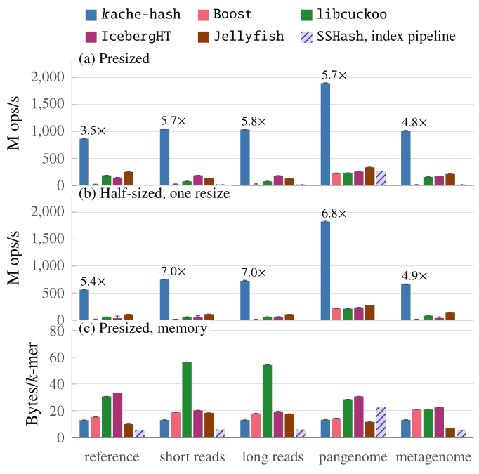
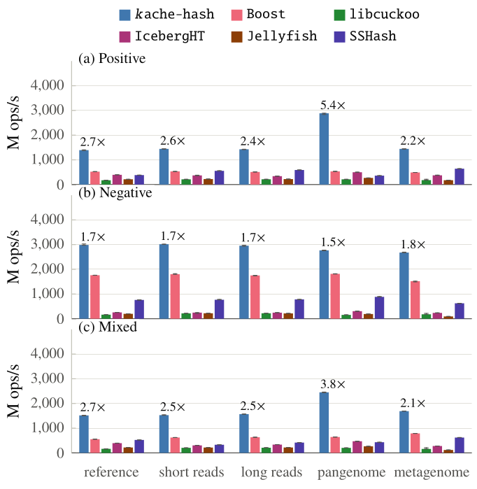

# *k*ache-hash

*k*ache-hash is a dynamic, concurrent, and cache-efficient hash table for streaming *k*-mer operations, where sequences of consecutive *k*-mers are processed in order.
It places each *k*-mer by its minimizer, so that consecutive *k*-mers tend to share a bucket, and its throughput scales with the number of user threads.
It provides sets of *k*-mers and maps from *k*-mers to values: in C++, as a header-only library, and in C and Rust, through a compiled library.

<figure markdown="span">
  { width="49%" }
  { width="49%" }
  <figcaption>Builds (left) and queries (right) of presized k-mer sets at 56 threads on five indexes, from Figs. 2 and 3 of the paper: kache-hash builds 3.5–5.8× faster than the fastest baseline on each index, at 13.0–13.3 bytes per distinct k-mer, and answers positive queries 2.2–5.4×, mixed ones 2.1–3.8×, and negative ones 1.5–1.8× faster.</figcaption>
</figure>

## Start here

- [Installation](install.md): CMake, conda, Cargo, or the headers alone.
- The guides to [the C++ tables](cpp.md), [counting *k*-mers within a set](counter.md), [the C interface](c.md), and [the Rust crates](rust.md).
- [Tuning](tuning.md) and [supported platforms](platforms.md).
- [Examples](examples.md) in C++, C, and Rust.
- The [API reference](https://jamshed.github.io/kache-hash/api/) of the C++ and C interfaces, from the headers, and [docs.rs](https://docs.rs/kache-hash) for the Rust crates.

*k*ache-hash is distributed under the BSD 3-Clause License; [Citation](citation.md) contains the paper's `bib` entry.
